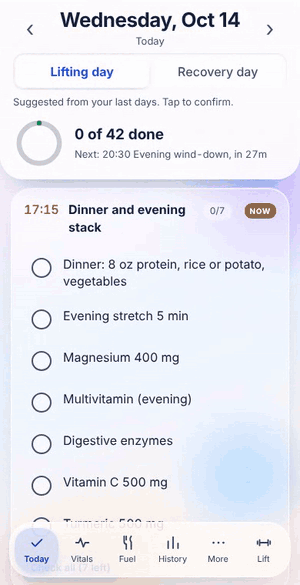

# Daily

A configurable daily regimen + lifting tracker. TypeScript source compiles to **one self-contained HTML file** — no server, no framework, no build dependencies beyond the TypeScript compiler.



**Try it: https://jasonzawacki-arch.github.io/daily/** (sample data; installable, works offline).

## What it does

- **Daily checkoffs** — regimen items organized into time windows (morning, training, meals, evening, pre-bed), with weekday / day-of-week filters and date-gated items
- **Dose planner** — "up next" scheduling, missed-dose flags, and a dose-change log with chart markers
- **Titration view** — weight, blood pressure, and sleep trends around dose changes (stepping up a GLP-1, for example), with lab values overlaid
- **Injectable medications** — doses left in each vial or pen, discard dates, spare vials, and injection-site rotation, for weekly or daily injections such as a GLP-1
- **Gut tracking** — quick-tap symptoms with severity and time, the Bristol scale, food tags (with FODMAP groups) and fiber on meals; a Gut patterns screen compares symptoms after each food against other meals, with counts and a minimum sample before anything is flagged, plus fiber and water on symptom days, an elimination plan with reintroduction results, and prompts to contact a clinician for red flags
- **Supplies and reorders** — stock per item (open container plus sealed ones), used up automatically as you check items off; how long each lasts and the date to reorder, allowing for each store's delivery time; a reorder plan that groups what is due so one order covers it; subscriptions checked against what you actually use ("stock builds up, try every 8 weeks"); prescription items shown as refills, never prices; an optional label reader that fills in a new supply from a photo, and a Prices button that finds the 3 best current prices by AI web search, both using your own Claude, OpenAI or Gemini key, which stays on the device (prescription items and injectables get no price lookup)
- **Lift tracking** — workout templates, set logging with validation warnings, progressive-overload analytics, weekly volume by muscle
- **Reports** — one-page PDF summaries and weekly reviews
- **Local-first** — all data stays in IndexedDB on the device; optional cloud backup to the user's own store
- **Extras** — dark/light themes with contrast auditing, PIN lock, voice input for logging

## Install on your phone

**https://jasonzawacki-arch.github.io/daily/** is the same app, published from this repository. Open it in Chrome on Android, then tap the menu (three dots) and **Install app**. It gets its own icon and works offline.

- It opens on Lift the first time, then on whichever side you used last. The checklist starts with an everyday sample regimen (supplements, meals, water, walks). Make it yours under **More > Customize and settings**: hide sample items and add your own, each with its time window and days (every day, weekdays, Mon/Thu or Mondays). Vial tracking and the medication cycle appear once you add an injectable item. To bring over data you already have, use **Backup** (or **Transfer code**) where you have it now, then **Restore from backup file** (or **Restore from pasted backup**) in the app. Backups include the regimen, so your own list comes with them.
- A whole regimen can also be a file: **More > Customize and settings > Regimen** saves the current one as `daily-regimen.json` and loads another. A loaded regimen stays on that device and goes into its backups. See [Regimen files](#regimen-files).
- Everything stays in the phone's browser storage. Download a backup now and then (**More > Reports and backup**); clearing Chrome's site data deletes the app's data.
- Cloud backup needs Daily to be opened inside Claude, so in the installed app it explains that instead.

*Publishing (once, for the repository owner):* **Settings > Pages > Source: GitHub Actions**. The `phone app` workflow then publishes `dist/site` on every push to `main`.

## Sync across devices (optional)

The installed app can keep the same data on a phone and a computer through the user's own Google Drive: **More > Reports and backup > Sync with Google Drive**. Nothing changes for anyone who skips it, and no sign-in is ever needed to use or try the app.

- Daily keeps one file in the hidden app folder of the user's Drive (`daily-sync.json`); no server of ours is involved. Each storage key (a day, a workout, settings, the regimen, the program) carries its last change time, and the newer change wins key by key. Photos stay on the device.
- The first sync on a device that already has data asks whether to combine both, use the Drive copy, or replace it.
- A browser app without a server gets Google access for about an hour at a time. While it lasts, changes sync on their own; after that a **Sync** button appears and one tap syncs again.
- Inside Claude, Daily uses Claude's own cloud backup instead.

### Setting up Google sign-in (once, for the person who publishes the app)

Sync stays hidden until the app has a Google OAuth client ID. One ID works for both Daily and JobLedger, because both are published from the same address.

1. Open https://console.cloud.google.com, sign in, and create a project (for example "Daily and JobLedger").
2. **APIs & Services > Library**: find **Google Drive API** and click **Enable**.
3. **Google Auth Platform > Get started**: app name, support email, audience **External**, contact email, then **Create**.
4. **Data Access > Add or remove scopes**: add `https://www.googleapis.com/auth/drive.appdata`, then **Save**. Only this Drive scope is used; it reaches a hidden folder for this app and nothing else in the user's Drive.
5. **Audience > Test users**: add your own Google account. While the app is in testing, only test users can sign in. To let anyone sign in, click **Publish app**; drive.appdata is a non-sensitive scope, so Google asks only for basic app verification.
6. **Clients > Create client**: type **Web application**, and under **Authorized JavaScript origins** add `https://jasonzawacki-arch.github.io`. Click **Create** and copy the client ID (it ends in `.apps.googleusercontent.com`).
7. Put the ID in `GOOGLE_CLIENT_ID` in `src/gsync-config.ts` here and in JobLedger (`src/engine/gsync-config.ts`), then push. The client ID is not a secret: it names the app to Google.

## Regimen files

The checklist (time windows, items, version notes and a few labels) is data, not code. The built-in one is [`src/regimen.json`](src/regimen.json); a file loaded in the app replaces it on that device. So one public app can run a private regimen: the regimen lives only on the phone and in its backups, and a private copy of this repository only needs its own `src/regimen.json`.

```json
{
 "format": "daily-regimen", "version": 1, "name": "My plan",
 "windows": [["06:00", "Morning"], ["12:00", "Midday"], ["21:30", "Lights out"]],
 "items": [[0, "Vitamin D3 2,000 IU", "A"], [1, "Walk 20 min", "A", "wd"], [2, "Magnesium 400 mg", "A", "", "2026-11-01"]],
 "notes": [["v1", "Nov 1, 2026", ["Started the plan."]]]
}
```

- `windows`: `[time, name]` in time order; the last one is lights out.
- `items`: `[window number from 0, label, "A" every day | "L" lifting days | "R" recovery days, days "" | "wd" weekdays | "mt" Mon/Thu | "mo" Mondays, start date]`. Check marks are stored by position, so add new items at the end when you edit a regimen you already use.
- Optional: `peptides` (pattern for injectables given only in the abdomen), `bpLow`, `voice`, `procedure`, `retire` and `sleep`. See `src/regcheck.ts` for each one. Labels cannot contain `<` or `>`.

## Lifting programs

Build any routine in the app (Lift > Program): name days, add exercises with sets, reps and notes, make days rest days, and reorder days. Two schedules:

- **Rotating cycle**: days run in order and the next day follows your last completed workout, so a missed day never shifts the plan (good for 2 on / 1 off style splits).
- **Fixed weekdays**: 7 days, Monday first; today's workout is whatever is on today's weekday.

**Start from a template** offers 19 ready-made programs, tagged by experience level, goal and days a week, to use as they are or as a starting point:

- **Beginner**: Novice linear A/B, 5x5 strength, GZCLP, Full body 3 days, Push pull legs 3 days, Minimalist 2 days, Dumbbells at home, Bodyweight basics
- **Intermediate**: Push pull legs (6 days), PHUL, Upper lower, 5/3/1 Boring But Big, Texas Method, Bro split 5 days, Powerbuilding 4 days
- **Advanced**: Dorian Yates HIT, Heavy Duty HIT, PHAT, Arnold split

A new install opens on a short setup: units, then a program picked from this list (or keep the sample to look around). No sign-in is asked for; Google Drive backup is offered once, after three finished workouts.

**Logging a set:** tap the set number to log it with the suggested weight (or last session's) and last session's reps; the rest timer starts on its own. Type over any number to change it. They live in [`src/programs.json`](src/programs.json), in the same format as a program file, so adding a template is adding an entry there. Optional `level` (Beginner, Intermediate, Advanced) and `goal` tag a template in the picker.

### Program files

**Save program file** writes the current program as `daily-program.json`; **Load program file** replaces it (with Undo). Any template can be saved as a file too, to edit on a computer and load back. A regimen file can carry a program under `"program"`, so one file can set up both sides.

```json
{
 "format": "daily-program", "version": 1, "name": "My upper lower", "sched": "week",
 "days": [
  {"n": "Upper", "ex": [{"n": "Bench press", "s": 3, "r": "6-8"}, {"n": "Barbell row", "s": 3, "r": "8-10", "t": "Pause at chest"}]},
  {"n": "Lower", "ex": [{"n": "Back squat", "s": 3, "r": "5"}]},
  {"n": "Rest", "off": true, "ex": []},
  {"n": "Upper", "ex": [{"n": "Overhead press", "s": 3, "r": "8-10"}]},
  {"n": "Lower", "ex": [{"n": "Deadlift", "s": 2, "r": "5"}]},
  {"n": "Rest", "off": true, "ex": []},
  {"n": "Rest", "off": true, "ex": []}
 ]
}
```

- `sched`: `"week"` (exactly 7 days, Monday first) or `"cycle"` (1 to 14 days, the default). `"off": true` marks a rest day.
- Each exercise: `n` name, `s` sets (1 to 10), `r` reps like `8` or `6-8`; optional `t` note, `g` muscle group, `rp` rest-pause, `ss` superset with the next one, `wu` warm-up text.
- Optional `about` (one line), and `"hit": true` for one working set to failure with feeder sets and short rest options.

## Tech

TypeScript (Shadow DOM, IndexedDB), a dependency-free custom bundler (`build.mjs`), and Python/Playwright end-to-end tests.

## Build & test

```sh
npm install                           # installs the TypeScript compiler
node build.mjs                          # -> dist/daily.html, and dist/site/ (the installable app)
tsc -p .                                # type-check
python3 tests/smoke.py dist/daily.html  # Playwright smoke test
python3 tests/standalone.py             # the installed app: no Claude, offline, backup files
python3 tests/regimen.py                # regimen files: save, load, refuse bad files, backups
python3 tests/program.py                # programs: files, templates, weekly schedule, day controls
python3 tests/gsync.py                  # Google Drive sync, against a stand-in for Google
```

## Data

Ships with clearly-labeled **sample data** so every feature is demonstrable out of the box. Replace it with your own regimen — user data is stored locally in IndexedDB and never leaves the device.
